# Promo Profit Lab

**Which grocery promotions actually make money, how much should suppliers fund, and where should the promotion budget go?**

> **TL;DR**
> - Every $1 of promotion spend returns **−33¢** of gross profit, because 45% of promoted units would have sold anyway. Promotions break even only when suppliers fund about a third of the extra discount.
> - Displays and deli promotions pay back; price cuts don't. Promotions do **not** lift spend on other items, and targeted campaigns are **not proven**.
> - Shallower discounts and a budget shift recover **$153k per $1M** of promotion spend (47% of the loss) with no new money.

An end-to-end promotion P&L: a tested SQL data model, causal measurement, a budget optimiser, business-analysis artefacts and an executive recommendation. Built on 1.46 million real basket lines from 2,469 households (84.51° *The Complete Journey*).

**Live dashboard:** https://lakshays007.github.io/Promo-Profit-Lab/  ·  **Power BI report:** [powerbi/](powerbi/)  ·  **CEO memo:** [docs/CEO_MEMO.md](docs/CEO_MEMO.md)  ·  **Requirements:** [docs/BRD.md](docs/BRD.md)  ·  **BA pack:** [docs/ba](docs/ba)

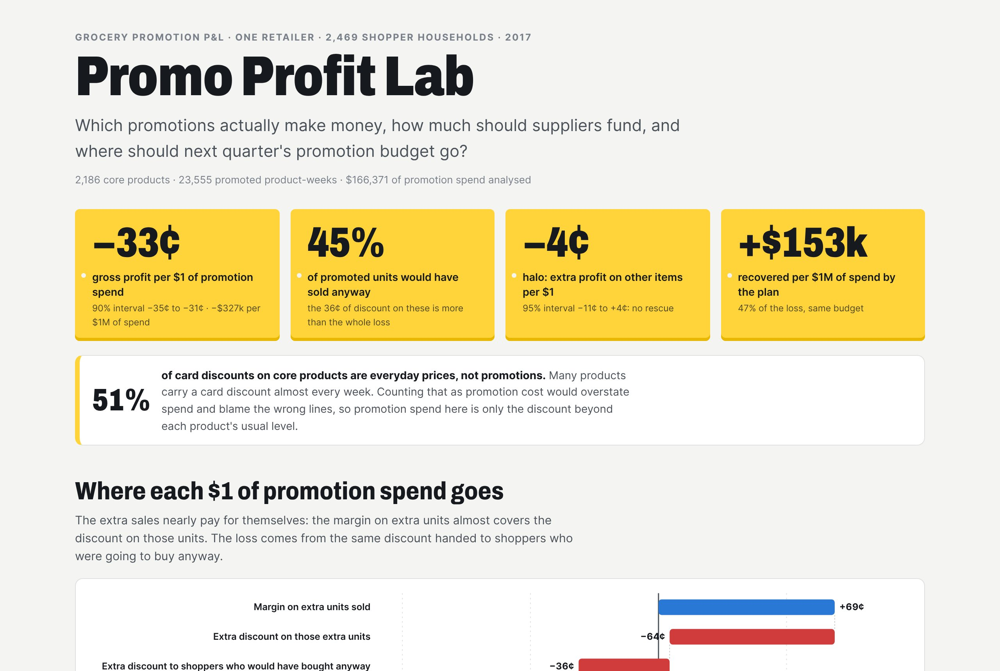

## Why it matters

Promotions are one of the largest controllable costs in grocery. Australian supermarkets run weekly catalogue and shelf-ticket specials, and supplier co-funding of those specials is a regular subject of negotiation and public scrutiny. The questions here are the ones a category, pricing or commercial-finance team asks every quarter: which promotions earn their keep, and what should suppliers contribute?

## Findings

| | Finding |
|---|---|
| **−33¢** | Incremental gross profit per $1 of promotion spend (90% interval −35¢ to −31¢), or **−$327k per $1M**. |
| **45%** | Promoted units that would have sold anyway. The discount on them (36¢ per $1) is more than the whole loss: the extra sales themselves nearly pay back. |
| **33%** | Supplier funding needed to break even overall. It ranges from 0% (in-store displays, deli and bakery) to 59% (grocery price cuts). |
| **51%** | Card discounts on core products that are everyday prices, not promotions. Counting them would have doubled promotion spend and blamed the wrong lines. |
| **−4¢** | Basket halo per $1 (95%: −11¢ to +4¢). More promotions mean more spend on promoted items, but not on anything else. |
| **Not proven** | Targeted campaigns: +$0.34 a week per household (95%: −$1.14 to +$1.82), below the smallest effect the data can detect ($2.12). A naive comparison says +$40. |

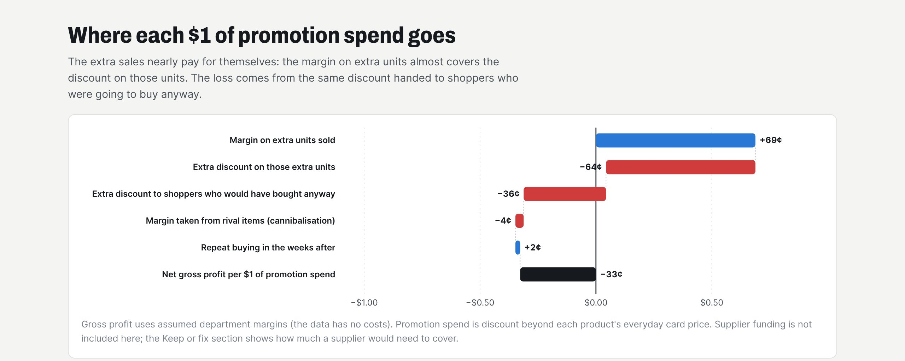

## Recommendations

| # | Action | Impact per $1M of promotion spend |
|---|---|---|
| 1 | Make supplier funding the entry ticket: each promotion runs only above its break-even funding share | Every line pays back at its target |
| 2 | Cut the extra discount by 5 points on the 8 Fix lines and move budget to lines that lose least | **+$153k** ($108k shallower discounts + $46k reallocation), 47% of the loss |
| 3 | Hold out a random 10–20% of households from every campaign | ~7,850 households per group detects a 3% lift (with CUPED) |

| | |
|---|---|
| 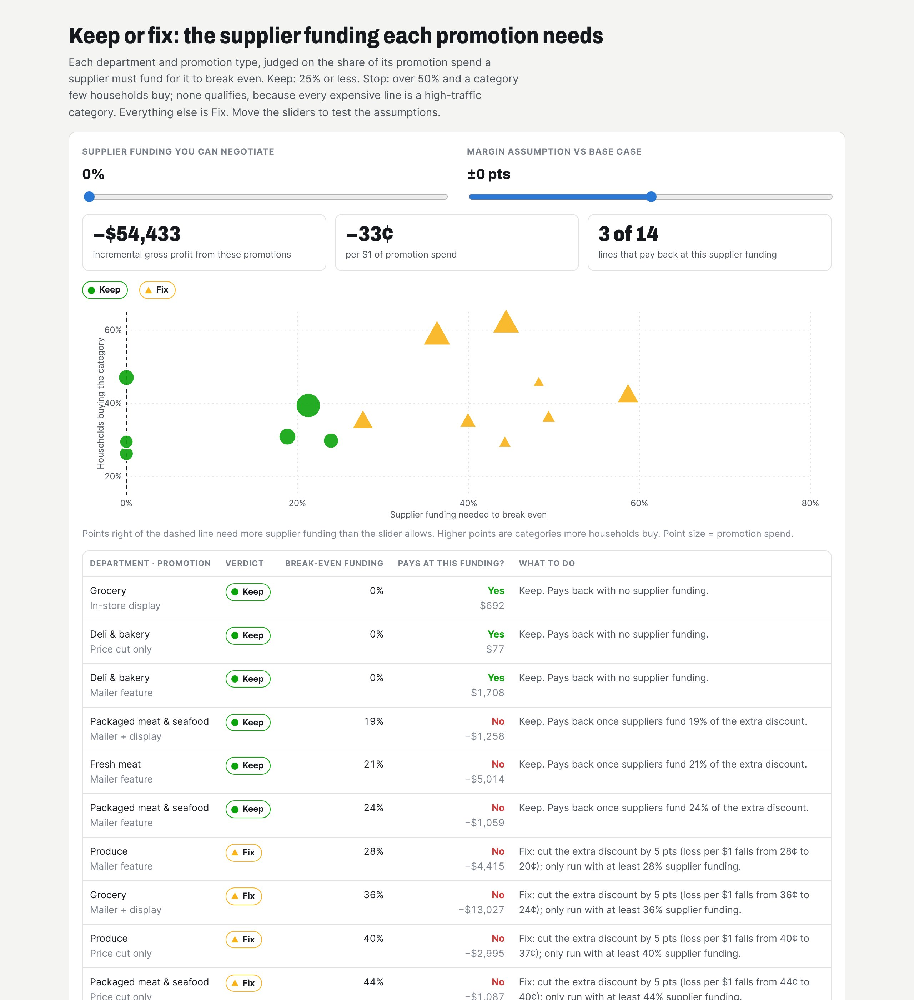 | 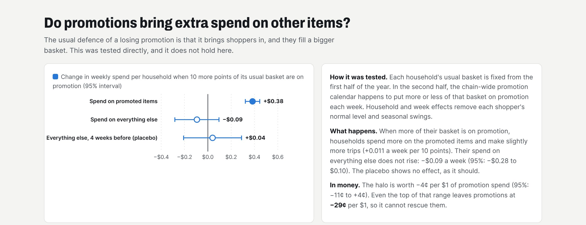 |
| 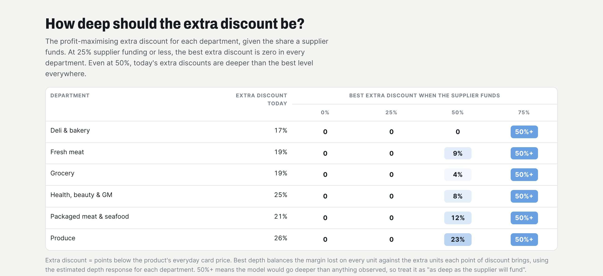 | 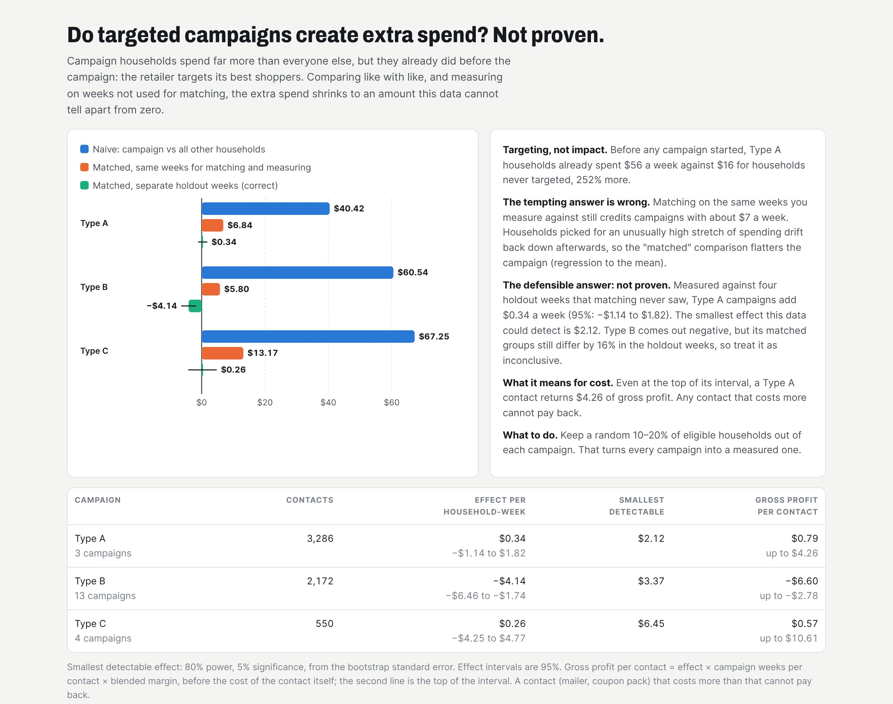 |

## Power BI report

A five-page executive report built in Power BI Desktop on a star schema (fact table of promoted product-weeks, date and product dimensions, decision lines), with 34 DAX measures including a 4-week moving average, a `RANKX` loss ranking, what-if parameters for supplier funding and margin, and measure-driven conditional colours. Every page leads with an action title.

| Page | Headline |
|---|---|
| Summary | Promotions lose 33¢ per $1, driven by discounts to shoppers who would buy anyway |
| Where the loss comes from | Displays pay back; price cuts lift sales least and give away the most discount |
| Keep or fix | 6 of 14 promotion lines pay back once suppliers fund 25%; the other 8 need redesign |
| Campaigns | Campaign effect is too small to prove: targeted shoppers already spent 3–6× more |
| The plan | The plan recovers $153k per $1M of promotion spend (47% of the loss) with no new money |

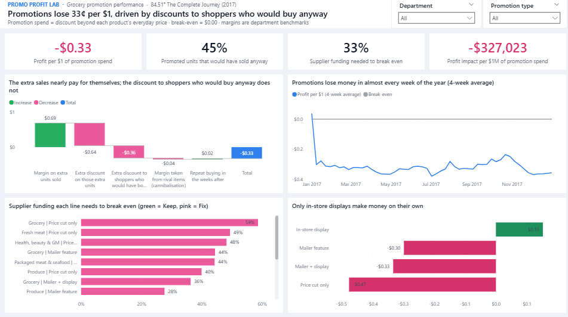

| | |
|---|---|
| 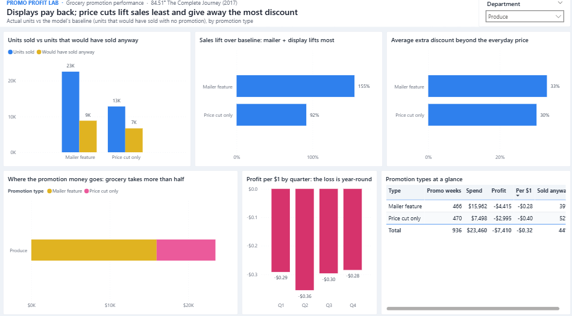 | 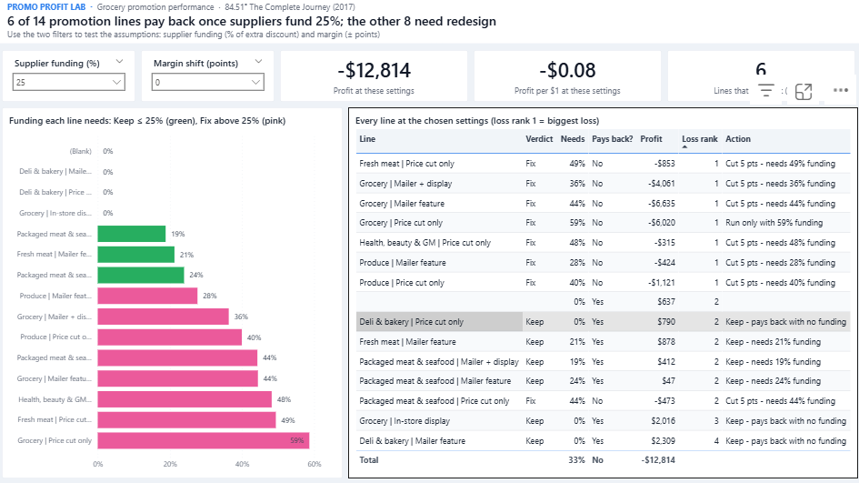 |
| 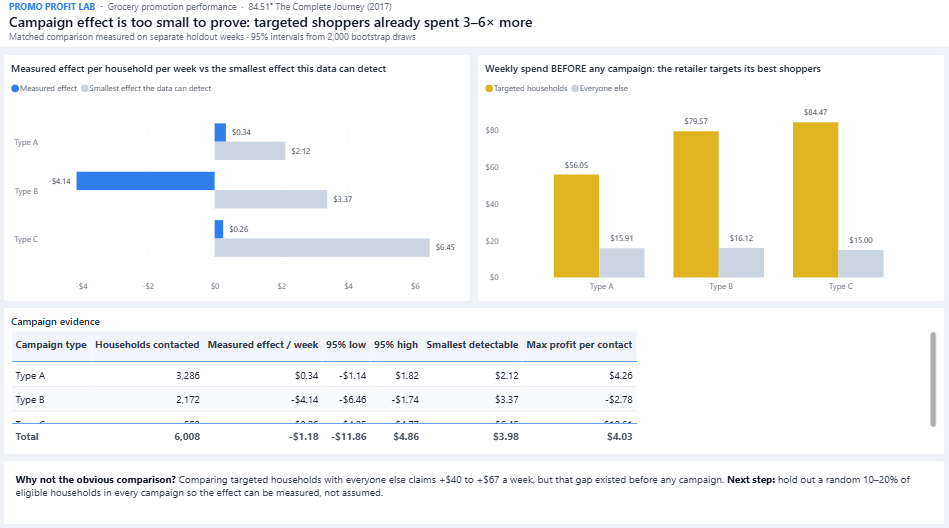 | 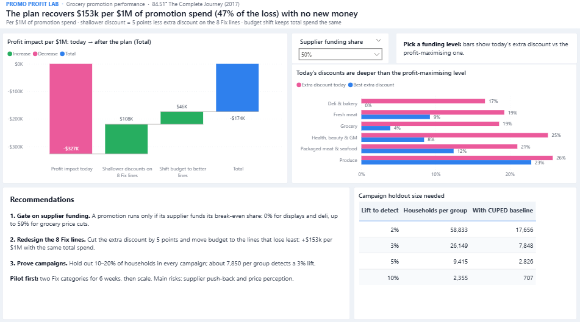 |

Open `powerbi/Promo_Profit_Lab_PowerBI/Promo_Profit_Lab.pbip` in Power BI Desktop, point the **DataFolder** parameter at `powerbi\data\`, and refresh. [powerbi/BUILD_GUIDE.md](powerbi/BUILD_GUIDE.md) explains how to build it by hand.

## How it works

| Stage | What | Tools |
|---|---|---|
| **Requirements** | BRD, as-is and to-be process maps, user stories with acceptance criteria, traceability matrix, RACI, benefits case, roadmap and risk register ([docs/ba](docs/ba)) | Mermaid, Markdown |
| **Data model** | Staging and mart layers with 19 data tests: uniqueness, relationships, accepted values, and reconciliation to raw sales to the cent. Separates everyday card pricing from promotional discount. The tests caught 12,785 duplicate rows in the source promotions table | SQL, dbt, DuckDB |
| **Promotion lift** | Two-way fixed-effects demand model on 116k product-weeks: lift by promotion type and extra discount, after-effects, and cannibalisation. Validated on 4,709 held-out promotion events (bias −1.8%). Each of 23.6k promoted product-weeks is costed into incremental gross profit, with intervals from 300 coefficient draws | Python, pandas, statsmodels |
| **Halo** | Shift-share household panel: fixed first-half preferences × the chain's promotion calendar, household and week fixed effects, and a placebo | Python, statsmodels |
| **Campaign impact** | Nearest-neighbour matching and difference-in-differences, with separate matching and holdout weeks to remove regression-to-the-mean bias, a placebo check and detectable-effect sizing | Python, NumPy |
| **Decisions** | Break-even supplier funding, Keep/Fix/Stop rules, optimal extra discount by supplier share, a linear-programming budget optimiser, and pilot sizing with CUPED | SciPy (HiGHS), statsmodels |
| **Delivery** | Five-page Power BI report (star schema, 34 DAX measures, what-if parameters), interactive web dashboard, CEO memo and executive deck | Power BI, DAX, HTML/JS |

The full method is in [docs/METHOD.md](docs/METHOD.md).

### Two traps this analysis avoids

- **Everyday prices booked as promotions.** Half of all card discounts are a product's normal price. Version 1 counted them as promotion cost, which roughly doubled promotion spend and made the result look worse (−53¢). Promotion spend now counts only the discount beyond each product's usual level.
- **Regression to the mean in campaign measurement.** Matching and measuring on the same weeks credited campaigns with +$6.84 a week. Households picked during an unusually high stretch drift back down, which flatters the campaign. Measuring against separate holdout weeks gives +$0.34.

## Run it

```bash
pip install -r requirements.txt
./run_all.sh            # gets the data, builds and tests the warehouse, runs the analysis, rebuilds the dashboard
```

About 5 minutes end to end. The dashboard is written to `docs/index.html`, and the Power BI tables to `powerbi/data/`.

## Repository

```
dbt/            SQL models, margin assumptions (seed) and 19 data tests
analysis/       01 lift model · 01b halo · 02 campaigns · 03 decisions · 04 exports · 05 dashboard build · 06 Power BI tables
out/            Results: CSV and JSON
docs/           Dashboard (GitHub Pages), CEO memo, BRD, method, screenshots
docs/ba/        Process maps, user stories, traceability, data dictionary, stakeholders and roadmap
powerbi/        Power BI project (.pbip), data tables, DAX measures, build guide
tests/          11 consistency checks on the outputs
data/           How to get the raw data
```

## Assumptions and limits

- **No cost prices in the data.** Gross margins are department benchmarks: grocery 25%, produce 40%, meat 28%, deli 40%, bakery 55%, health and general merchandise 30% (Naveo Commerce, 2023, via AgMRC). They are tested ±10 points. Even at +10 points, promotions lose 9¢ per $1 without supplier funding.
- **Supplier funding and mailing costs are not observed.** The base case assumes the retailer pays the whole extra discount; the sliders show the effect of supplier funding.
- **Sample.** One retailer, one year (2017), a 2,469-household panel. Lift is measured on the 2,186 products that sold in at least 45 of 53 weeks (59% of sales).
- **Simulated engagement.** The stakeholders, process maps and roadmap are illustrative. The data and every number are real.

## How this was built

Designed and analysed by Lakshay Saini, with an AI assistant (Claude) used for code drafting, review and documentation. Every number is produced by the code in this repository and checked by the tests.

## Data

84.51° *The Complete Journey*, provided for research and educational purposes. Accessed through the [`completejourney-py`](https://github.com/cunningjames/completejourney_py) package (MIT). See [data/README.md](data/README.md).

© 2026 Lakshay Saini. Released under the MIT licence (see [LICENSE](LICENSE)). Not affiliated with 84.51°, dunnhumby or any retailer.
