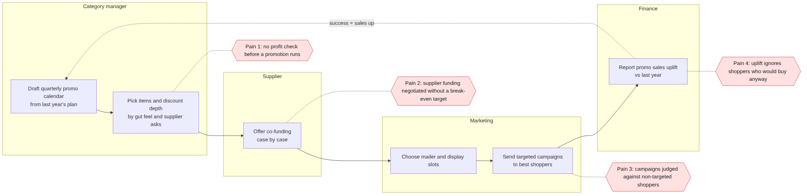
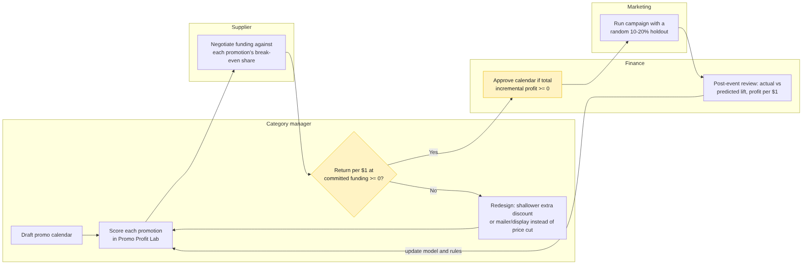

# Promotion planning: process, stakeholders and roadmap

*Simulated engagement. The process below is a typical grocery promotion cycle, used to show how the analysis would be adopted. It was not observed at the retailer that supplied the data.*

## As-is process

| # | Pain point | Evidence from the data | Cost |
|---|---|---|---|
| P1 | No profit check before a promotion runs | 8 of 14 department × promotion-type lines lose money even at 25% supplier funding | −33¢ per $1 of promotion spend |
| P2 | Supplier funding negotiated without a target | Break-even funding varies from 0% to 59% by line, and nothing ties the ask to it | Weak negotiating position |
| P3 | Campaigns judged against shoppers who were never targeted | Targeted households already spent 3.5× more before any campaign | A +$40/week "effect" that is really +$0.34 |
| P4 | "Uplift" counts shoppers who would have bought anyway | 45% of promoted units would have sold without the promotion | 36¢ of every promotion $1 is a giveaway |
| P5 | Everyday card prices booked as promotion cost | 51% of card discounts on core products are the usual price, not a promotion | Promotion cost overstated, and the wrong lines blamed |

## To-be process

| Change | Gate | Owner |
|---|---|---|
| Every proposed promotion is scored before it is booked | Return per $1 at committed supplier funding ≥ 0, or a stated strategic reason | Category manager |
| Supplier funding is negotiated against each promotion's break-even share | Funding ≥ break-even share | Buying team |
| Price-led promotions use the optimal extra discount for the funding agreed | Extra discount ≤ the optimal level in the pricing rule table | Pricing |
| Every targeted campaign keeps a random holdout | 10–20% of eligible households held out | Marketing |
| Post-event review compares actual with predicted lift | Model updated quarterly | Analytics |

## Stakeholders

| Stakeholder | Interest | Influence | What they need from this work | Likely objection |
|---|---|---|---|---|
| CFO | Margin, cash | High | Profit per $1, total impact, risk | "Is the margin assumption right?" (answered with the ±10-point sensitivity) |
| Category director | Category sales and share | High | Keep/Fix/Stop list by line | "Promotions drive traffic" (answered by the halo test) |
| Buying team | Supplier terms | Medium | Break-even funding share per promotion | "Suppliers won't agree" (start with lines needing least) |
| Marketing | Campaign results | Medium | Holdout design, sample sizes | "Holdouts lose sales" (a 10% holdout costs little and makes every result provable) |
| Store operations | Display execution | Low | Which displays to keep | None expected: displays are the best performer |

## RACI: promotion approval (to-be)

| Activity | Category manager | Buying | Pricing | Marketing | Finance | Analytics |
|---|---|---|---|---|---|---|
| Draft calendar | **A/R** | C | C | C | I | C |
| Score promotions | R | I | C | I | I | **A** |
| Negotiate supplier funding | C | **A/R** | I | I | C | C |
| Set extra discount depth | C | C | **A/R** | I | I | C |
| Approve calendar | C | I | I | I | **A/R** | C |
| Campaign holdout design | I | I | I | **A/R** | I | R |
| Post-event review | R | I | I | R | C | **A** |

R = responsible, A = accountable, C = consulted, I = informed.

## Benefits case (per $1M of promotion spend)

| Lever | Annual impact | Confidence |
|---|---|---|
| Shallower extra discounts on the 8 "Fix" lines (−5 points) | **+$108k** gross profit | Medium: uses the estimated depth response |
| Move budget to the lines that lose least (same total spend) | **+$46k** | Medium: assumes constant returns within ±50% of today's spend |
| **Total** | **+$153k**, 47% of the current loss | |
| Supplier funding at each line's break-even share | Takes every line to ≥ 0 | Depends on negotiation |

## Roadmap

| Phase | Weeks | Deliverable | Success measure |
|---|---|---|---|
| Pilot | 1–6 | Two Fix categories run at −5 points extra discount; one campaign with a random holdout | Measured profit per $1 vs prediction; campaign effect with a confidence interval |
| Scale | 7–12 | Scoring gate in the planning calendar; break-even targets in supplier negotiations | ≥ 80% of promotions scored before booking |
| Embed | 13–26 | Quarterly model refresh; post-event review in the monthly trading meeting | Return per $1 improving each quarter |

## Risks

| Risk | Likelihood | Impact | Mitigation |
|---|---|---|---|
| Margin assumptions are wrong | Medium | Medium | Results shown at ±10 points; the direction holds across the range |
| Suppliers refuse higher funding | Medium | High | Start with lines needing the least funding; redesign mechanics instead |
| Shallower discounts hurt price perception | Medium | Medium | Keep traffic categories at ≥ 80% of spend; track basket count weekly |
| Results don't transfer from the household panel to all stores | Low | Medium | The pilot measures it directly before scale-up |
